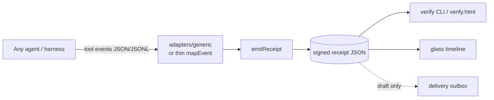

# Architecture

## One-liner

**Producer** (any agent) emits tool events → **emitReceipt** signs digests → **verify / glass** consume the same receipt JSON.

## Flow

## Layers

| Layer | Path | Responsibility |
|-------|------|----------------|
| Schema | `src/schema/receipt.js` | Receipt fields (`receiptVersion`, digests, producer, …) |
| Crypto | `src/crypto/` | canonicalize, sha256 digests, Ed25519 sign/verify, keys |
| Producer API | `src/producer/emit-receipt.js` | **Unified** `emitReceipt({ toolName, args, result, producer, … })` |
| Demo | `src/producer/demo-loop.js` | Local two-tool demo via emitReceipt |
| Adapters | `adapters/generic` + examples | Observe/export only — **no owned agent loop** |
| Verify | `verify/`, `src/cli/verify.js` | Offline green/red |
| Glass | `glass/` | C4 display shell over receipts |
| Delivery | `delivery/` | IM **draft** only |

## Adapter boundary

- **In:** tool-event objects (generic schema) or vendor-shaped rows + `mapEvent`.  
- **Out:** signed receipts on disk.  
- **Forbidden:** implementing a product agent loop, multi-channel Gateway, or requiring 26 vendor SDKs.

## Trust model (short)

Verify checks: signature matches `canonicalize(receipt without signature)` under `receipt.publicKey`.  
Trusting a green receipt means trusting that **public key** (and that digests match the args/result you care about). Key distribution is out of band for 0.x.
